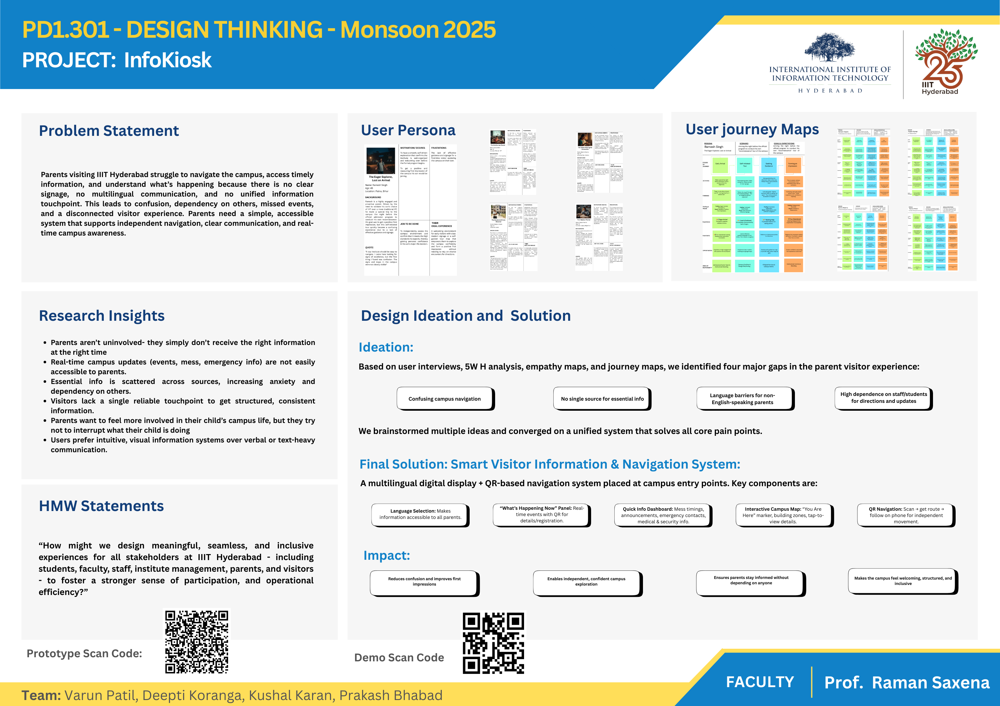

# InfoKiosk: visitor information and navigation system for IIIT Hyderabad

Design thinking project · Team Idearc · Aug – Dec 2025

**[Clickable prototype](https://app.visily.ai/projects/5c24a1c6-3af7-4dcb-81da-dcb8bda9e784/boards/2365425/presenter?play-mode=All+screens)** ·
**[Demo video](https://drive.google.com/file/d/1Fl8Bs8gzErr4GsTOVKuYdgMzHNChK3Bw/view?usp=drive_link)** ·
**[Poster](poster.png)** ·
**[Full deck (PDF)](InfoKiosk_deck.pdf)**

---

## Summary

Parents who visit IIIT Hyderabad deal with more campus stakeholders than any other
visitor group: security at the gate, reception, their child, the mess and the
administration. Yet there is no single place for them to find out where to go or
what is happening on campus. They end up relying on guards and students for
directions and updates, and miss events they would have liked to attend.

We studied the problem from the parents' side and from the institute's side,
narrowed it to one actionable problem statement, and designed **InfoKiosk**: a
multilingual information kiosk with QR-based navigation at the campus entrance.
The concept was checked with parents, security staff and facilities staff before
it was prototyped, and the prototype was tested with parents.

---

## The brief

> How might we design meaningful, seamless and inclusive experiences for all
> stakeholders at IIIT Hyderabad — students, faculty, staff, institute
> management, parents and visitors — to foster a stronger sense of participation
> and operational efficiency?

The brief was deliberately broad. The first job was to find the group and the
problem worth solving.

---

## Process at a glance

| Stage | What we did | What came out of it |
|---|---|---|
| **Discover** | Open brainstorming and affinity mapping of the campus ecosystem; secondary research (news, visitor reviews, comparison with ISB Hyderabad and IIT Hyderabad); stakeholder map of 11 visitor groups | Parents identified as the visitor group with the most stakeholder contact and the least structured support |
| **Research** | 8 open-ended telephonic interviews with parents who had visited, recorded and transcribed; 5W-H analysis of every insight | 5 personas, empathy maps and a journey map per persona, with pain points at each touchpoint |
| **Define** | Problem framed from three points of view: parents, students and administration | 4 How-Might-We statements, compared with RICE, and one final problem statement |
| **Ideate** | Round-robin brainstorming, 13 rounds (What If, Opposite Thinking, SCAMPER) | 50+ ideas, grouped into 4 themes and compared with RICE; "real-time information" selected |
| **Validate** | Concept checked with security guards, parents and campus facilities staff | 10–15 parents visit every day (guards); demand for events, navigation and visual information (parents); kiosk confirmed as feasible to install, fund and maintain (facilities) |
| **Design** | User task analysis; feature brainstorm; 13 features scored on impact, ease, frequency, value and feasibility | Prioritised feature list, low-fidelity wireframes, high-fidelity prototype |
| **Test** | Prototype walked through with parents over video call | Bilingual labels and a usage hint added to the home screen |

---

## Who the solution had to work for

| Stakeholder | What they need | How InfoKiosk addresses it |
|---|---|---|
| **Parents** | Clarity, connection and confidence during the visit | Live events, a campus map and QR directions in their language, without having to ask anyone |
| **Students** | Not to be the only channel between their parents and the campus | Parents get campus information directly instead of through their child |
| **Administration** | Smooth operations, security and a good impression of the institute | One official, consistent visitor touchpoint at the gate; fewer routine questions for security staff |

---

## What the research showed

- Parents are not uninvolved — they simply don't get the right information at the right time.
- Real-time campus information (events, mess timings, emergency contacts) is hard for them to reach.
- What they need is scattered across sources, which adds anxiety and makes them depend on others.
- There is no single reliable touchpoint that gives visitors structured, consistent information.
- Parents want to feel part of their child's campus life but try not to interrupt them.
- They prefer simple, visual information over verbal or text-heavy communication.

**Final problem statement:** How might we design a communication experience for
parents visiting IIIT Hyderabad that keeps them connected to ongoing campus
happenings, so that it leads to higher parent–institute engagement and helps them
feel part of the IIIT Hyderabad community?

---

## The solution

A multilingual digital display with QR-based navigation, placed at campus entry points.

| Component | What it does |
|---|---|
| **Language selection** | Makes every screen usable for parents who don't read English |
| **"What's happening now"** | Real-time events, each with a QR code for details or registration |
| **Quick info** | Mess timings, announcements, emergency, medical and security contacts |
| **Interactive campus map** | "You are here" marker, building zones, tap to see details |
| **QR navigation** | Scan, get the route on your phone, and walk there on your own |

**Feature priority.** Real-time event updates, the campus map, live event details
and important announcements scored highest across all five criteria and form the
core. Event registration, the mess menu and emergency contacts came next.
Payments, lost and found and student achievements were ranked lower and left
for later.

---

## Testing and what changed

The prototype was tested with 2 parents over video call, walking them through how
it would be used at the campus gate. They explored events, the map, the mess menu
and the QR flow, and said it would make information clearer and reduce their
reliance on guards for directions. They also said too much text would overwhelm
them.

Changes made: **bilingual labels** throughout, and a **short usage hint** on the
home screen.

**Limitation.** The parents were not on campus during testing, so the gate
context had to be explained to them. The next step would be an on-site test at
the entrance with parents during a real visit.

---

## Artefacts

| Stage | Link |
|---|---|
| Brainstorming | [Board](https://drive.google.com/file/d/1uBKtcfPgbDepE1w0Oe8a_4gT3WNtabR_/view?usp=sharing) |
| Affinity mapping | [Board](https://drive.google.com/file/d/1bRzqzzz82_gUDU7z3X6wEGK0lK7Rn9mu/view?usp=drive_link) |
| 5W-H grid | [Grid](https://drive.google.com/file/d/1tJrmn43cOEb4TMcJXJdX4WTvge7gaKsu/view?usp=drive_link) |
| Personas | [Personas](https://drive.google.com/file/d/1sw7A6chKv1JKLhbcOf1NMdujF9lzAzWD/view?usp=drive_link) |
| Empathy maps | [Maps](https://drive.google.com/file/d/14_SMl9Wz02BUDcEFkPobTpVTeFVMhgt2/view?usp=drive_link) |
| Journey maps | [Maps](https://drive.google.com/file/d/16Vux1v8ofDs02bUcP1VpenXZc4cd2l1T/view?usp=drive_link) |
| Points of view | [POVs](https://drive.google.com/file/d/1niEqRgZs1oBVsM9lWwWZLZLP0L3X52Sz/view?usp=drive_link) |
| Round-robin ideation | [Ideas](https://drive.google.com/file/d/1pAX1rMkFjp6tIgLmjC3IDndAYA2IMQHX/view?usp=drive_link) |
| Idea clustering | [Clusters](https://drive.google.com/file/d/1lF-q3OsnR27LFVm30Ekg4Xymtz7jz3c6/view?usp=drive_link) |
| User task analysis | [Flowchart](https://drive.google.com/file/d/1hwTdshyVxvpCXWscbAmjxfo9O95BIuGt/view?usp=drive_link) |
| Feature brainstorm | [Board](https://drive.google.com/file/d/1e83uc1uuqqBCNsOj4hm9fjz4c4sJHl6d/view?usp=drive_link) |
| Low-fidelity wireframes | [Wireframes](https://drive.google.com/file/d/1Eos3dOy2ODhitdQsILdGY5gXKfB8yYVy/view?usp=drive_link) |
| High-fidelity screens | [Screens](https://drive.google.com/file/d/1cZ05tZmXkICoa6NV69LyUYqV1sRRt0t0/view?usp=drive_link) |

---

## Team

Team Idearc: Varun Patil, Deepti Koranga, Kushal Karan, Prakash Bhabad.
Design Thinking, IIIT Hyderabad, Monsoon 2025. Faculty: Prof. Raman Saxena.
